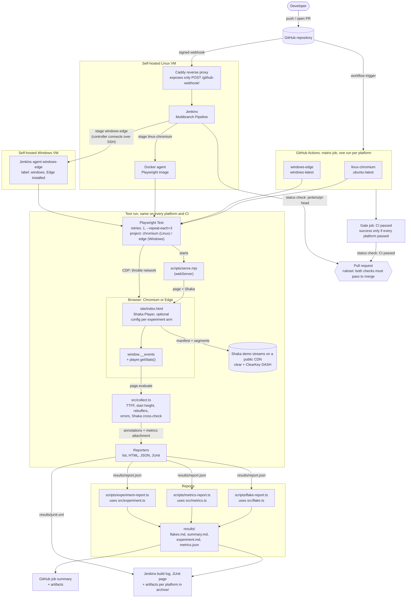

# Architecture

The detailed picture behind the [README](README.md): how a change travels through CI, what happens inside a test run, and where the security boundaries are.

## How a change reaches `main`

- **Two CI systems, one test run.** GitHub Actions runs on GitHub's machines. Jenkins runs on two self-hosted VMs, triggered by a GitHub webhook: the controller and its Docker agent on a Linux VM, and a Windows agent on a Windows VM. Both CIs run the same commands, so the test run in the middle is identical.
- **Two platforms, one test codebase.** `playwright.config.ts` picks the browser from the OS. Each CI runs the same steps on Linux and Windows in parallel and reports one overall result: GitHub Actions through a matrix job and a gate job, Jenkins through parallel stages on a Linux and a Windows agent.
- **Two required checks.** The merge ruleset requires `CI passed` from GitHub Actions and `continuous-integration/jenkins/pr-head` from Jenkins. Both are reported on every commit of every pull request. That is the rule for a required check: one that only sometimes reports blocks merging forever. Jenkins' `branch` status is deliberately *not* required, because Jenkins skips branch builds once a branch has an open PR.

## Inside a test run

- **Measurements come from inside the browser.** The page records timestamped events; `src/collect.ts` reads them out after playback and turns them into metrics.
- **Metrics travel through Playwright's own reporters.** Each run attaches its metrics as JSON, and its experiment and arm as annotations. The JSON reporter collects every attempt into `results/report.json`, which is the single input to all three report scripts.
- **The network is controlled from the test, not the page.** The throttling test uses a Chrome DevTools Protocol session to cut bandwidth mid-playback, which works in Chromium and Edge alike.

## Security boundaries

- **Only the webhook is public.** Caddy forwards just `POST /github-webhook/` to Jenkins; everything else gets a 404, and the Jenkins UI stays private (it has root-equivalent access to its VM through the Docker socket). GitHub signs each delivery with a shared secret that Jenkins verifies.
- **The controller calls out to the Windows agent, not the other way round.** Jenkins opens an SSH connection to the Windows VM with its own key, stored as a credential only Jenkins itself can use, and checks the VM's pinned host key. The Windows machine never needs to reach Jenkins; it only has to accept SSH from the Jenkins VM.
- **Pull requests from forks are not built** on Jenkins, so untrusted code never runs on the self-hosted machines.
