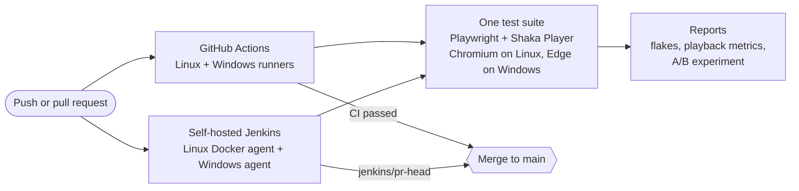

# Playback-test-harness

[](https://github.com/tsuls/Playback-test-harness/actions/workflows/ci.yml)

A small quality platform for a video player, built in TypeScript with Playwright and Shaka Player. It answers the questions a player team asks before every change ships: does playback still start quickly, does it recover from a bad network, does content protection still work on each platform, which tests can we trust, and is a new player setting actually better?

It plays real DASH streams in two browsers on two operating systems, Chromium on Linux and Microsoft Edge on Windows, and measures playback quality from the player's own events: time to first frame, starting resolution, rebuffering and errors. It cross-checks those numbers against Shaka's internal statistics, tells real failures apart from flaky tests, runs A/B experiments on player configuration, and gates every pull request on two CI systems, GitHub Actions and a self-hosted Jenkins with Linux and Windows agents.

## Quick start

```sh
npm ci
npx playwright install chromium   # Linux only; Windows uses the installed Edge
npm test              # type check + all tests
npm run report        # flake, metrics and experiment reports from the last run
npm run experiment    # the A/B experiment with enough runs to decide (10 per arm)
npm run test:chaos    # demo: a deliberately flaky test, run 10 times (POSIX shells only)
```

Developed and verified on Node 22, which is also what CI uses.

## Architecture



The same suite runs on every platform and both CIs, and a pull request merges only when both CIs pass. [ARCHITECTURE.md](ARCHITECTURE.md) has the detailed diagram: the measurement pipeline inside a test run, how reports reach each CI, and the security boundaries around the self-hosted machines.

## Measuring playback quality

`site/index.html` is a small test page that loads Shaka Player, plays the manifest given in `?src=`, and pushes timestamped events into `window.__events`. Playwright opens the page, lets it play, then reads the events and `player.getStats()` back out.

| Metric | Definition |
| --- | --- |
| **Time to first frame (TTFF)** | From the page calling `player.load()` to the first frame the browser presents (`requestVideoFrameCallback`). |
| **Start height** | The resolution of that first frame: the quality playback started at. |
| **Rebuffer count and time** | Each `waiting` event after the first `playing`, until the next `playing`. Startup buffering is not a rebuffer. |
| **Errors** | Every error event, as `source:code` (e.g. `shaka:3014`, `video:3`). |

Each run attaches its metrics to the test, and `scripts/metrics-report.ts` aggregates them across runs into `results/metrics.json` and a Markdown table, with TTFF p50 and p95 (nearest-rank percentiles).

### Checking the numbers against the player's own

A metric is only useful if it can be trusted, so every run also records Shaka's view of the same playback and the two are compared:

- **Rebuffers agree.** Rebuilding rebuffers from Shaka's `stateHistory` with the same definition matches ours to within about 1 ms.
- **`bufferingTime` is higher than our rebuffer time,** because Shaka also counts startup buffering.
- **`stallsDetected` stays at 0 even during a real stall.** Shaka's stall detector fires when the playhead is stuck *with* data buffered (a decoder problem), not when the buffer runs empty. It measures something different from rebuffering, and a dashboard that used it as a rebuffer count would report zero stalls during real ones.

### Tests

| Test | What it checks |
| --- | --- |
| Codec support | The browser reports H.264/AAC support through `MediaSource.isTypeSupported`. |
| Clear stream | A clear DASH stream starts, plays 5 s, has a sane TTFF and no errors. |
| ClearKey, right key | An encrypted stream decrypts through EME (`org.w3.clearkey`) and plays. |
| ClearKey, wrong key | A negative control: with a wrong key, decoding fails. Proves the test above really depends on decryption. |
| Throttled stall | ABR is turned off to pin the top bitrate, bandwidth is cut through the Chrome DevTools Protocol until the buffer runs dry, then restored. Asserts a rebuffer was detected and the playhead moves again. |
| DRM capabilities | Records which key systems the platform offers (`requestMediaKeySystemAccess`) as an annotation and a JSON attachment. Asserts ClearKey everywhere. |
| Edge offers Widevine (`@edge`) | Windows only: Edge offers Widevine. |
| Experiment arms (`@experiment`) | Plays the same stream under each arm's player configuration and records its metrics; see *A/B experiments*. |

## Platforms and content protection

Each platform tests its own browser, and every test runs on both unless it is tagged for one platform, so platform differences show up as test results rather than as separate codebases.

| | Linux | Windows |
| --- | --- | --- |
| Browser | Playwright's bundled Chromium (project `chromium`) | Installed Microsoft Edge, `channel: 'msedge'` (project `edge`) |
| Browser setup | `npx playwright install --with-deps chromium` | None: Edge comes with Windows |
| Platform-only tests | none | tagged `@edge`; `chromium` skips them with `grepInvert` |
| ClearKey | ✅ | ✅ |
| Widevine | ❌ (the open-source build has no CDM) | ✅ |
| PlayReady | ❌ | ❌ on the VMs we can test (see below) |

**Widevine on Edge needed one flag removed.** Playwright launches browsers with `--disable-component-update`, which stops Edge from registering its bundled Widevine module. The `edge` project drops that flag (`launchOptions.ignoreDefaultArgs`), and Widevine then works as in a normal install.

**PlayReady isn't tested, and the reason is worth knowing.** Edge on a GPU-less Windows Server VM (a cloud VM, and GitHub's Windows runners) never offers PlayReady at any security level, SL2000 included, even though Windows' PlayReady component is installed. Edge reports software-only rendering there (SwiftShader, Microsoft Basic Render Driver), and PlayReady most likely needs a hardware graphics path. That is a strong hypothesis rather than a proven cause: confirming it needs the same test on real Windows hardware with a GPU. It is also a general lesson about device testing: a cloud machine is not the device your users have.

**Windows shell:** the npm scripts and CI steps avoid POSIX-only syntax, except `npm run test:chaos` (`CHAOS=1 …`). CI runs every step with bash (Git Bash on Windows), so the commands are identical on both platforms.

## A/B experiments

Tests say whether the player works. Experiments say whether a change makes it *better*. `tests/experiment.spec.ts` plays the same stream under two player configurations, tags each run with its experiment and arm, and `scripts/experiment-report.ts` compares the arms. The comparison (`compareArms` in `src/experiment.ts`) uses the p50 of a lower-is-better metric and only calls a winner when each arm has enough runs and the change is large enough to stand out from network noise. Otherwise the verdict is *inconclusive*.

**The experiment: what should the player assume about bandwidth before it has measured any?** That first guess picks the starting quality.

- **Control:** Shaka as shipped. In Chromium-based browsers it takes its first guess from the browser's own estimate (`navigator.connection.downlink`, about 10 Mbit/s here), so it starts at the top quality.
- **Treatment:** a conservative start. Assume 100 kbit/s and ignore the browser's estimate, so playback starts at the lowest quality and switches up.

Results from three batches of 10 runs per arm (Linux + Chromium):

| Arm | TTFF p50 (ms) | Start height | Rebuffers | Errors |
| --- | --- | --- | --- | --- |
| control | 475–499 | 576p | 0 | none |
| treatment | 400–411 | 144p | 0 | none |

The conservative start reaches the first frame about 16–18% sooner in every batch, but starts at a quarter of the height (144p vs 576p, a sixteenth of the pixels). That is the real decision behind the setting: a faster start versus a sharper first few seconds. Neither arm rebuffered, so the guardrail held. Edge on Windows points the same way.

Two things the experiment taught:

- **A setting can be silently ignored.** The first attempt changed only `defaultBandwidthEstimate`, and both arms started at 576p. Shaka uses the browser's Network Information estimate whenever it is available, so the setting had no effect until `useNetworkInformation` was turned off as well. Without checking the start height, the experiment would have reported "no difference" for a change that never happened.
- **Small samples mislead.** An early probe of 6 runs per arm, with a slightly different control, pointed the *other* way. That is why the verdict needs a minimum number of runs. Both CI systems run the experiment in its own job with 10 runs per arm, as `npm run experiment` does locally, so every pull request gets a real verdict for each platform. A production experiment would also randomise the order of runs, use far more samples on real user traffic, and test for significance rather than use a fixed threshold.

## Flaky tests

1. The suite runs with `retries: 1` and, in CI, `--repeat-each=3`.
2. A run that fails and then passes on its retry is labelled **flaky** by Playwright. A run that fails both attempts is a **failure**.
3. Playwright's JSON reporter writes every attempt to `results/report.json`.
4. `scripts/flake-report.ts` reads that file and prints, per test: runs, passes, failures, flaky runs and the flake rate (flaky / runs).

`tests/chaos.spec.ts` is a clearly labelled demonstration test that fails about 30% of the time, so the report has something to catch. It only runs with `CHAOS=1` (`npm run test:chaos`); everywhere else, CI included, it is skipped, which accounts for 3 skips per CI run (one per repeat). Running it in CI would make builds random: about 9% of the time (0.3 × 0.3) it would fail both attempts and turn a pull request red for no reason.

### Should a flaky test fail CI?

Here, no: **flaky runs are tracked, not blocking.** CI fails only on a real failure (a test that fails both attempts). The trade-off:

| Fail CI on flakes | Don't fail CI on flakes |
| --- | --- |
| Flakes can't pile up unnoticed, and a "flaky" test is sometimes hiding a real bug, such as a race condition in the player. | A flaky failure is usually not caused by the pull request, so blocking it punishes the wrong change. |
| Forces someone to fix or quarantine the test. | Avoids teaching people to hit "re-run" until CI is green, a habit that ends up hiding real failures too. |
| | Tolerates network noise, which matters for tests that stream from a public CDN. |

The usual compromise is to keep pull requests lenient but make flakes impossible to ignore: every run publishes the flake report, and a stricter run elsewhere fails on any flake (see *What to add next*).

## Sample results

From a local Linux + Chromium run with `--repeat-each=3` (test names shortened):

| Test | Runs | TTFF p50 (ms) | TTFF p95 (ms) | Rebuffers | Rebuffer ms | Shaka rebuffers | Shaka rebuffer ms | Errors |
| --- | --- | --- | --- | --- | --- | --- | --- | --- |
| Throttled stall | 3 | 559 | 599 | 3 | 9814 | 3 | 9813 | none |
| Clear stream | 3 | 455 | 477 | 0 | 0 | 0 | 0 | none |
| ClearKey, right key | 3 | 633 | 813 | 0 | 0 | 0 | 0 | none |

And the chaos demo, 10 runs:

| Test | Runs | Passes | Failures | Flaky | Flake rate |
| --- | --- | --- | --- | --- | --- |
| DEMO: fails randomly about 30% of the time | 10 | 6 | 1 | 3 | 30% |

CI writes the flake and metrics tables to each platform's summary page, and the experiment table to the experiment job's, so a developer sees them on the pull request without digging through logs, and uploads the HTML report and `results/` as artifacts (`playwright-report-<platform>`, `results-<platform>`).

## CI/CD

Every pull request runs the full suite on both platforms in two CI systems, and merging needs both to pass. The aim is fast, trustworthy feedback: one clear check per system, reports where developers already look, and no checks that block merges for reasons unrelated to the change.

### GitHub Actions

[`ci.yml`](.github/workflows/ci.yml) has three jobs:

- **`playback`**, a *matrix* job: one definition, run in parallel on `linux-chromium` (`ubuntu-latest`) and `windows-edge` (`windows-latest`). `fail-fast: false` lets every platform finish and report even if another fails. It runs everything except the experiment arms.
- **`experiment`**, the same matrix running only the A/B experiment, 10 runs per arm. In its own job the arms get enough samples for a verdict and don't compete for the machine with the rest of the suite. It fails only if the guardrail fails (a playback error); a *worse* verdict is reported, not enforced.
- **`CI passed`**, a gate job that `needs` both and succeeds only if every job on every platform did. It is the one check the merge ruleset requires, so adding a platform never means editing the ruleset. It runs with `if: always()`: otherwise a platform failure would *skip* the gate, and GitHub treats a skipped required check as passing.

It runs on pull requests, and on pushes to `main` only. Running on every push as well would report each job twice per PR.

### Jenkins

The same pipeline is defined for Jenkins in [`Jenkinsfile`](Jenkinsfile), as it would be for a team running its own CI and device lab. A Multibranch Pipeline job builds every branch and pull request, triggered by the GitHub webhook, and reports one status check back to the PR.

The pipeline has `agent none` and a `Platforms` stage that runs its stages in `parallel`, with `failFast false`, so one platform failing doesn't abort the other:

- **`linux-chromium`** runs inside Microsoft's Playwright Docker image, which already includes Chromium and its Linux libraries. It needs the Docker Pipeline plugin and Docker on the agent.
- **`windows-edge`** runs on any agent labelled `windows`, directly on the machine with `bat` steps (no Docker). The agent needs Java, Node 22, Git and Edge. The Jenkins controller connects to it over SSH (SSH Build Agents plugin), so the Windows machine never has to reach Jenkins and the Jenkins UI stays private.
- **`linux-chromium-experiment`** and **`windows-edge-experiment`** run the A/B experiment with 10 runs per arm, like the `experiment` job in GitHub Actions. The Windows agent has one executor, so its experiment stage waits for `windows-edge` and then runs on the same machine.

| | GitHub Actions (`ci.yml`) | Jenkins (`Jenkinsfile`) |
| --- | --- | --- |
| Where it runs | GitHub's Ubuntu and Windows machines | Your agents: Docker on Linux, a self-hosted Windows VM |
| Two platforms | A matrix job | Parallel stages, each with its own `agent` |
| Experiment | Its own matrix job | Its own stage per platform |
| One overall result | Gate job `CI passed` | The pipeline's own status |
| Browser setup | Linux: `npx playwright install --with-deps chromium`; Windows: none | Linux: already in the image; Windows: none |
| Steps | `steps:` with `run:` (bash on both) | `sh` on Linux, `bat` on Windows |
| Run even if tests fail | `if: ${{ !cancelled() }}` | `post { always { … } }` |
| Reports | Job summary page | Build log, plus archived `archive/<platform>/results/*.md` |
| Per-test results | Inline in the logs and HTML report | JUnit page from `results/junit.xml` |
| Artifacts | `actions/upload-artifact`, named per platform | `archiveArtifacts` of `archive/<platform>/` |

Two Windows details:

- **Artifact paths.** Both stages produce `results/` and `playwright-report/` in the same build, and `archiveArtifacts` can't add a prefix, so one would overwrite the other. `scripts/archive-results.mjs` copies them into `archive/<platform>/` first. It's written in Node so the same command works on both OSes.
- **`call npx …`.** On Windows `npx` is a `.cmd` script, and without `call`, `cmd` hands control to it and never runs the `|| echo skipped` that follows.

JUnit XML has no "flaky" status: a test that passes on retry shows up in Jenkins as a plain pass. The flake report is what makes flakiness visible on both systems.

### Pipeline lessons

Most of the pipeline work was debugging, and the lessons generalise:

- **A required check must report on every pull request,** or it blocks merging forever. A gate that is *skipped* counts as passing, so the gate runs with `if: always()`. And once a branch has an open pull request, Jenkins builds only the pull request, so the required Jenkins check is `pr-head`, not `branch`. (A branch pushed *before* its PR is opened gets one `branch` build too, which shows up as an extra, non-required check.)
- **Duplicate triggers double the noise.** Triggering on both `push` and `pull_request` reported every job twice per PR, until `push` was limited to `main`.
- **Windows breaks quietly.** An unquoted `C:\Program Files\…` path stopped the Jenkins agent from launching, and `.cmd` scripts swallow the rest of a `bat` line without `call`.

## Known constraints

- **DRM:** Playwright's Chromium has no Widevine, and no CI machine here offers PlayReady (see *Platforms and content protection*), so the playback tests use clear streams plus one ClearKey stream. ClearKey exercises the same EME path without a licence server.
- **Clear lead:** the ClearKey demo stream's first few seconds are unencrypted, so *any* key appears to work at the start. The ClearKey tests start playback at 20 s to get past it.
- **Codecs:** Playwright's bundled Chromium supports H.264/AAC and VP9, so the `chrome` channel isn't needed. On both platforms Shaka chooses VP9 video with AAC audio for these streams, and each run records the codecs actually used (a `codecs` annotation).
- **Network variance:** streams come from a public CDN, so timings vary between runs and machines. Assertions check behaviour ("a rebuffer happened and playback recovered"), not exact numbers, and use generous timeouts. With only 3 runs, p95 is effectively the slowest run.

## How this was built

This project was built with an AI coding assistant (Claude Code), deliberately treated as part of the workflow rather than a shortcut. [`CLAUDE.md`](CLAUDE.md) is the rule set it worked under:

- It works in phases and stops for review after each one.
- It must verify every claim by running the tests and show the evidence.
- It never commits or pushes; every change was reviewed and committed by hand.
- It leaves the core logic (`src/metrics.ts`, `src/flake.ts`, `src/experiment.ts`) to be written by hand.

The rule that mattered most was "verify, don't assume". The assistant's first explanation of the missing PlayReady was wrong, a report was once read stale after a CLI flag silently replaced the configured reporters, and the first version of the experiment changed a setting the player ignored. Each was caught because the rules demanded evidence.

## Project layout

```
site/index.html              test page: Shaka Player + event recording
src/streams.ts               stream URLs (all verified to load)
src/types.ts                 shared types
src/collect.ts               read events/stats from the page, compute run metrics
src/metrics.ts               percentiles
src/flake.ts                 flake classification
src/experiment.ts            compare two experiment arms
src/report.ts                read Playwright's JSON report
tests/                       playback, network, DRM capability, experiment and chaos tests
tests/unit/                  unit tests for the pure functions
scripts/flake-report.ts      JSON report → flake table
scripts/metrics-report.ts    JSON report → results/metrics.json + summary table
scripts/experiment-report.ts JSON report → experiment comparison
scripts/serve.mjs            static server started by Playwright's webServer
scripts/archive-results.mjs  copy reports into archive/<platform>/ for Jenkins
playwright.config.ts         projects: unit, plus chromium (Linux) or edge (Windows)
.github/workflows/ci.yml     playback + experiment matrix jobs (Linux + Windows) and the "CI passed" gate
Jenkinsfile                  the same pipeline for Jenkins: parallel Linux and Windows stages, plus experiment stages
ARCHITECTURE.md              detailed architecture diagram and security boundaries
```

## What to add next

- **Real TVs and streaming devices:** drive the same test page on living-room hardware, where decoders, memory, hardware DRM and network stacks differ most from a desktop browser.
- **A wider device matrix:** add Firefox, WebKit and macOS alongside Linux Chromium and Windows Edge.
- **PlayReady on real hardware:** run the Edge project on a Windows machine with a GPU, where Edge can offer PlayReady, and play a PlayReady-protected stream.
- **Regression alerts against a baseline:** store each `main` run's `metrics.json`, and flag a pull request when TTFF p95 or rebuffer time gets meaningfully worse than the baseline, or when a test's flake rate rises. This turns the metrics into a release gate.
- **A nightly strict run:** a scheduled CI run on `main` with Playwright's `--fail-on-flaky-tests`, so any flake turns the nightly build red and gets fixed the next day, while pull requests stay lenient.
- **Experiments under realistic networks:** run the experiment arms under throttled and variable bandwidth, where the start-quality trade-off matters most, with randomised run order and a significance test instead of a fixed threshold.
