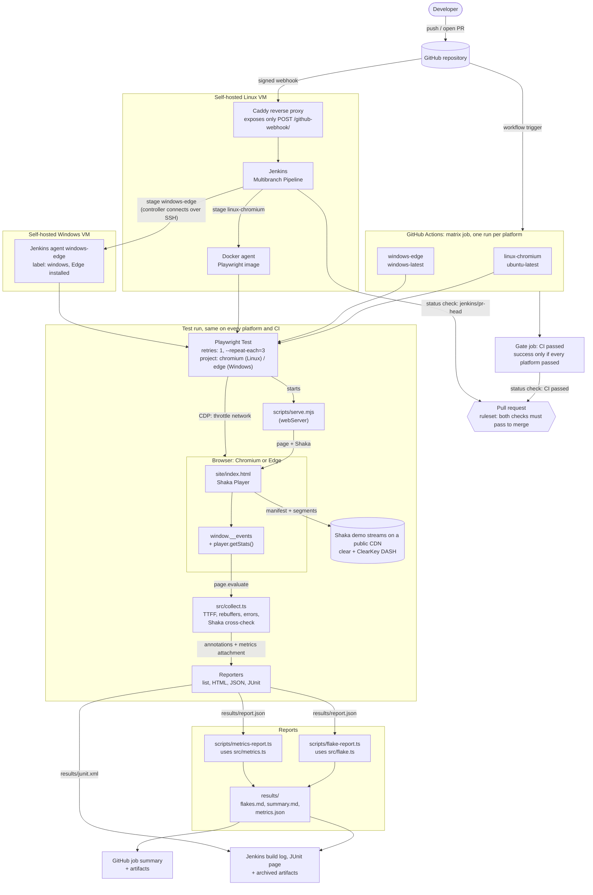

# Playback-test-harness

[](https://github.com/tsuls/Playback-test-harness/actions/workflows/ci.yml)

Automated video playback tests in TypeScript with Playwright and Shaka Player: time to first frame, rebuffering, errors, flake detection, and CI on every push.

It plays real DASH streams on two platforms, headless Chromium on Linux and Microsoft Edge on Windows, measures playback quality from the player's events, cross-checks those numbers against Shaka's own statistics, and reports which tests are flaky.

## Quick start

```sh
npm ci
npx playwright install chromium   # Linux only; Windows uses the installed Edge
npm test              # type check + all tests
npm run report        # flake table + metrics summary from the last run
npm run test:chaos    # demo: a deliberately flaky test, run 10 times (POSIX shells only)
```

Developed and verified on Node 22, which is also what CI uses.

## Architecture



- **Two CI systems, one test run.** GitHub Actions runs on GitHub's machines. Jenkins runs on a self-hosted VM, triggered by a GitHub webhook. Both run the same commands, so the test run in the middle is identical.
- **Two platforms, one test codebase.** `playwright.config.ts` picks the browser from the OS. Each CI runs the same steps on Linux and Windows in parallel and reports one overall result: GitHub Actions through a matrix job and a gate job, Jenkins through parallel stages on a Linux and a Windows agent.
- **Only the webhook is public.** Caddy forwards just `POST /github-webhook/` to Jenkins; everything else gets a 404, and the Jenkins UI stays private. GitHub signs each delivery with a shared secret that Jenkins verifies.
- **Measurements come from inside the browser.** The page records events; `src/collect.ts` reads them out and turns them into metrics, which travel through Playwright's reporters to the report scripts.

## What it measures, and how

`site/index.html` is a small test page that loads Shaka Player, plays the manifest given in `?src=`, and pushes timestamped events into `window.__events`. Playwright opens the page, lets it play, then reads the events and `player.getStats()` back out.

| Metric | Definition |
| --- | --- |
| **Time to first frame (TTFF)** | From the page calling `player.load()` to the first frame the browser presents (`requestVideoFrameCallback`). |
| **Rebuffer count and time** | Each `waiting` event after the first `playing`, until the next `playing`. Startup buffering is not a rebuffer. |
| **Errors** | Every error event, as `source:code` (e.g. `shaka:3014`, `video:3`). |

Each run attaches its metrics to the test, and `scripts/metrics-report.ts` aggregates them across runs into `results/metrics.json` and a Markdown table, with TTFF p50 and p95 (nearest-rank percentiles).

### Cross-check against Shaka

Every run also records Shaka's view of the same playback. What we found:

- **Rebuffers agree.** Rebuilding rebuffers from Shaka's `stateHistory` with the same definition matches ours to within about 1 ms.
- **`bufferingTime` is higher than our rebuffer time,** because Shaka also counts startup buffering.
- **`stallsDetected` stays at 0 even during a real stall.** Shaka's stall detector fires when the playhead is stuck *with* data buffered (a decoder problem), not when the buffer runs empty. It measures something different from rebuffering.

### Tests

| Test | What it checks |
| --- | --- |
| Codec support | Chromium reports H.264/AAC support through `MediaSource.isTypeSupported`. |
| Clear stream | A clear DASH stream starts, plays 5 s, has a sane TTFF and no errors. |
| ClearKey, right key | An encrypted stream decrypts through EME (`org.w3.clearkey`) and plays. |
| ClearKey, wrong key | A negative control: with a wrong key, decoding fails. Proves the test above really depends on decryption. |
| Throttled stall | ABR is turned off to pin the top bitrate, bandwidth is cut through the Chrome DevTools Protocol until the buffer runs dry, then restored. Asserts a rebuffer was detected and the playhead moves again. |
| DRM capabilities | Records which key systems the platform offers (`requestMediaKeySystemAccess`) as an annotation and a JSON attachment. Asserts ClearKey everywhere. |
| Edge offers Widevine (`@edge`) | Windows only: Edge offers Widevine. |

## Platforms

Each platform tests its own browser, and every test runs on both unless it is tagged for one platform.

| | Linux | Windows |
| --- | --- | --- |
| Browser | Playwright's bundled Chromium (project `chromium`) | Installed Microsoft Edge, `channel: 'msedge'` (project `edge`) |
| Browser setup | `npx playwright install --with-deps chromium` | None: Edge comes with Windows |
| Platform-only tests | none | tagged `@edge`; `chromium` skips them with `grepInvert` |
| ClearKey | ✅ | ✅ |
| Widevine | ❌ (the open-source build has no CDM) | ✅ |
| PlayReady | ❌ | ❌ on the VMs we can test (see below) |

**Widevine on Edge needed one flag removed.** Playwright launches browsers with `--disable-component-update`, which stops Edge from registering its bundled Widevine module. The `edge` project drops that flag (`launchOptions.ignoreDefaultArgs`), and Widevine then works as in a normal install.

**PlayReady isn't tested.** Edge on a GPU-less Windows Server VM (a cloud VM, and GitHub's Windows runners) never offers PlayReady at any security level, SL2000 included, even though Windows' PlayReady component is installed. Edge reports software-only rendering there (SwiftShader, Microsoft Basic Render Driver), and PlayReady most likely needs a hardware graphics path. Testing it needs real Windows hardware with a GPU.

**Windows shell:** the npm scripts and CI steps avoid POSIX-only syntax, except `npm run test:chaos` (`CHAOS=1 …`). CI runs every step with bash (Git Bash on Windows), so the commands are identical on both platforms.

## How flakes are detected

1. The suite runs with `retries: 1` and, in CI, `--repeat-each=3`.
2. A run that fails and then passes on its retry is labelled **flaky** by Playwright. A run that fails both attempts is a **failure**.
3. Playwright's JSON reporter writes every attempt to `results/report.json`.
4. `scripts/flake-report.ts` reads that file and prints, per test: runs, passes, failures, flaky runs and the flake rate (flaky / runs).

`tests/chaos.spec.ts` is a clearly labelled demonstration test that fails about 30% of the time. It only runs with `CHAOS=1`, so the report has something to catch.

### Should a flaky test fail CI?

Here, no: **flaky runs are tracked, not blocking.** CI fails only on a real failure (a test that fails both attempts). The trade-off:

| Fail CI on flakes | Don't fail CI on flakes |
| --- | --- |
| Flakes can't pile up unnoticed, and a "flaky" test is sometimes hiding a real bug, such as a race condition in the player. | A flaky failure is usually not caused by the pull request, so blocking it punishes the wrong change. |
| Forces someone to fix or quarantine the test. | Avoids teaching people to hit "re-run" until CI is green, a habit that ends up hiding real failures too. |
| | Tolerates network noise, which matters for tests that stream from a public CDN. |

The usual compromise is to keep pull requests lenient but make flakes impossible to ignore: every run publishes the flake report, and a stricter run elsewhere fails on any flake (see *What to add next*).

## Sample results

From a local run with `--repeat-each=3` (test names shortened):

| Test | Runs | TTFF p50 (ms) | TTFF p95 (ms) | Rebuffers | Rebuffer ms | Shaka rebuffers | Shaka rebuffer ms | Errors |
| --- | --- | --- | --- | --- | --- | --- | --- | --- |
| Throttled stall | 3 | 559 | 599 | 3 | 9814 | 3 | 9813 | none |
| Clear stream | 3 | 455 | 477 | 0 | 0 | 0 | 0 | none |
| ClearKey, right key | 3 | 633 | 813 | 0 | 0 | 0 | 0 | none |

And the chaos demo, 10 runs:

| Test | Runs | Passes | Failures | Flaky | Flake rate |
| --- | --- | --- | --- | --- | --- |
| DEMO: fails randomly about 30% of the time | 10 | 6 | 1 | 3 | 30% |

CI writes both tables to each platform's summary page and uploads the HTML report and `results/` as artifacts (`playwright-report-<platform>`, `results-<platform>`).

## GitHub Actions

[`ci.yml`](.github/workflows/ci.yml) has two jobs:

- **`playback`**, a *matrix* job: one definition, run in parallel on `linux-chromium` (`ubuntu-latest`) and `windows-edge` (`windows-latest`). `fail-fast: false` lets every platform finish and report even if another fails.
- **`CI passed`**, a gate job that `needs` the matrix and succeeds only if every platform did. It is the one check the merge ruleset requires, so adding a platform never means editing the ruleset. It runs with `if: always()`: otherwise a platform failure would *skip* the gate, and GitHub treats a skipped required check as passing.

It runs on pull requests, and on pushes to `main` only. Running on every push as well would report each job twice per PR.

## Jenkins

The same pipeline is also defined for Jenkins in [`Jenkinsfile`](Jenkinsfile), for teams that run their own CI server. A Multibranch Pipeline job builds every branch and pull request, triggered by the GitHub webhook, and reports one status check back to the PR.

The pipeline has `agent none` and a `Platforms` stage that runs two stages in `parallel`, with `failFast false`, so one platform failing doesn't abort the other:

- **`linux-chromium`** runs inside Microsoft's Playwright Docker image, which already includes Chromium and its Linux libraries. It needs the Docker Pipeline plugin and Docker on the agent.
- **`windows-edge`** runs on any agent labelled `windows`, directly on the machine with `bat` steps (no Docker). The agent needs Java, Node 22, Git and Edge. The Jenkins controller connects to it over SSH (SSH Build Agents plugin), with its own key and a pinned host key, so the Windows machine never has to reach Jenkins and the Jenkins UI stays private.

| | GitHub Actions (`ci.yml`) | Jenkins (`Jenkinsfile`) |
| --- | --- | --- |
| Where it runs | GitHub's Ubuntu and Windows machines | Your agents: Docker on Linux, a self-hosted Windows VM |
| Two platforms | A matrix job | Parallel stages, each with its own `agent` |
| One overall result | Gate job `CI passed` | The pipeline's own status |
| Browser setup | Linux: `npx playwright install --with-deps chromium`; Windows: none | Linux: already in the image; Windows: none |
| Steps | `steps:` with `run:` (bash on both) | `sh` on Linux, `bat` on Windows |
| Run even if tests fail | `if: ${{ !cancelled() }}` | `post { always { … } }` |
| Flake and metrics tables | Job summary page | Build log, plus archived `results/*.md` |
| Per-test results | Inline in the logs and HTML report | JUnit page from `results/junit.xml` |
| Artifacts | `actions/upload-artifact`, named per platform | `archiveArtifacts` of `archive/<platform>/` |

Two Windows details:

- **Artifact paths.** Both stages produce `results/` and `playwright-report/` in the same build, and `archiveArtifacts` can't add a prefix, so one would overwrite the other. `scripts/archive-results.mjs` copies them into `archive/<platform>/` first. It's written in Node so the same command works on both OSes.
- **`call npx …`.** On Windows `npx` is a `.cmd` script, and without `call`, `cmd` hands control to it and never runs the `|| echo skipped` that follows.

JUnit XML has no "flaky" status: a test that passes on retry shows up in Jenkins as a plain pass. The flake report is what makes flakiness visible on both systems.

## Known constraints

- **DRM:** Playwright's Chromium has no Widevine, and no CI machine here offers PlayReady (see *Platforms*), so the playback tests use clear streams plus one ClearKey stream. ClearKey exercises the same EME path without a licence server.
- **Clear lead:** the ClearKey demo stream's first few seconds are unencrypted, so *any* key appears to work at the start. The ClearKey tests start playback at 20 s to get past it.
- **Codecs:** Playwright's bundled Chromium supports H.264/AAC and VP9/Opus, so the `chrome` channel isn't needed. Shaka chooses VP9 for these streams, and each run records the codec actually used.
- **Network variance:** streams come from a public CDN, so timings vary between runs and machines. Assertions check behaviour ("a rebuffer happened and playback recovered"), not exact numbers, and use generous timeouts. With only 3 runs, p95 is effectively the slowest run.

## Project layout

```
site/index.html            test page: Shaka Player + event recording
src/streams.ts             stream URLs (all verified to load)
src/types.ts               shared types
src/collect.ts             read events/stats from the page, compute run metrics
src/metrics.ts             percentiles
src/flake.ts               flake classification
src/report.ts              read Playwright's JSON report
tests/                     playback, network, DRM capability and chaos tests
tests/unit/                unit tests for the pure functions
scripts/flake-report.ts    JSON report → flake table
scripts/metrics-report.ts  JSON report → results/metrics.json + summary table
scripts/serve.mjs          static server started by Playwright's webServer
playwright.config.ts       projects: unit, plus chromium (Linux) or edge (Windows)
.github/workflows/ci.yml   CI matrix (Linux + Windows) and the "CI passed" gate
Jenkinsfile                the same pipeline for Jenkins: parallel Linux and Windows stages
scripts/archive-results.mjs  copy reports into archive/<platform>/ for Jenkins
```

## What to add next

- **A wider device matrix:** add Firefox, WebKit and macOS to the matrix, alongside Linux Chromium and Windows Edge.
- **PlayReady on real hardware:** run the Edge project on a Windows machine with a GPU, where Edge can offer PlayReady, and play a PlayReady-protected stream.
- **Real TVs and streaming devices:** drive the same test page on living-room hardware, where decoders, memory and network stacks differ most from a desktop browser.
- **A nightly strict run:** a scheduled CI run on `main` with Playwright's `--fail-on-flaky-tests`, so any flake turns the nightly build red and gets fixed the next day, while pull requests stay lenient.
- **Regression alerts against a baseline:** store each `main` run's `metrics.json`, and flag a pull request when TTFF p95 or rebuffer time gets meaningfully worse than the baseline, or when a test's flake rate rises.
